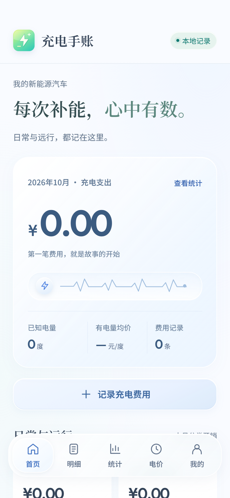
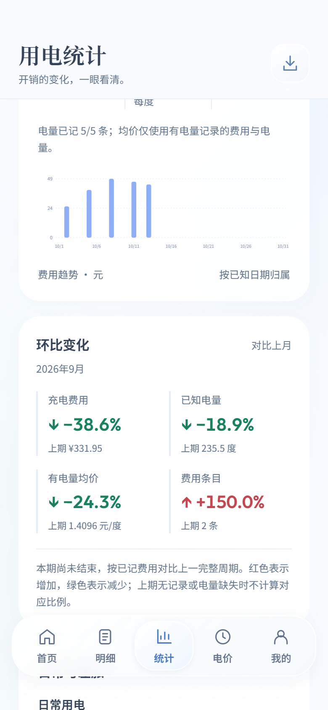
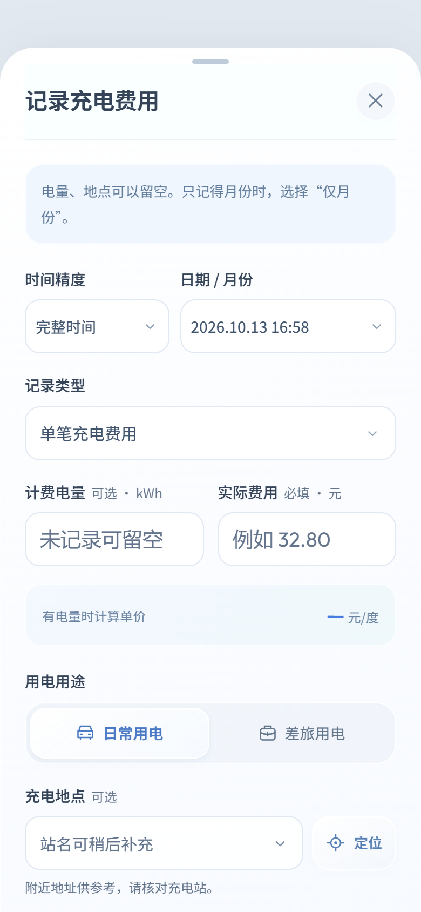

<div align="center">


# 充电手账 · Charge Ledger

**每次补能，心中有数。**

记录公用充电费用，分清日常与差旅，看懂每个周期的支出。

[](https://github.com/tonyai12138-cmd/charge-ledger/releases/latest)

[](https://github.com/tonyai12138-cmd/charge-ledger/actions/workflows/checks.yml)

**[下载 APK](https://github.com/tonyai12138-cmd/charge-ledger/releases/latest/download/ChargeLedger.apk)** · **[全部配套文件](https://github.com/tonyai12138-cmd/charge-ledger/releases/latest)** · **[使用指南](docs/USER_GUIDE.md)** · **[更新记录](CHANGELOG.md)**

</div>

## 界面预览

<p align="center">
  
  
  
  
</p>

预览由桌面浏览器生成，使用空账本或合成测试数据。APK 首次打开为空账本。[查看开屏演示](docs/images/launch.webm)（桌面浏览器录制）。

## 安装与覆盖升级

1. 从 [最新 Release](https://github.com/tonyai12138-cmd/charge-ledger/releases/latest) 下载 `ChargeLedger.apk`，在安卓手机文件管理器中打开。
2. 按系统提示允许该文件管理器安装应用；旧版用户直接选择更新，**无需卸载**。
3. 打开“充电手账”，点击“记录充电费用”。定位可拒绝，地点可手动填写。

当前正式版 **v1.3.2 / versionCode 7**，支持 Android 8.0（API 26）及以上，目标 API 35。包名为 `cn.chargeledger.app`，延续旧版签名，原有本地数据与 schema-1 备份兼容。升级前可从“我的”导出 JSON 备份。

Release 配套提供安装包、完整源码 ZIP、使用指南、电价资料来源、验证报告、升级校验信息和 `SHA256SUMS.txt`。仅从本仓库 Release 下载正式安装包。

## 能做什么

| 场景 | 功能 |
| --- | --- |
| 每次补能 | 金额、时间、度数、地点、运营商、备注；有电量时自动算综合单价 |
| 补录旧账 | 电量与地点可留空；完整时间、仅日期、仅月份均可记录；支持差旅行程合计 |
| 日常 / 差旅 | 每笔标记用途；明细、统计、导出按用途筛选 |
| 查看趋势 | 日、周、月、季、年汇总；费用、电量、加权均价、条目数及上一周期环比 |
| 管理明细 | 搜索、筛选、编辑、删除与回收站；历史 JSON 追加导入预览与重复检查 |
| 交给外部 AI | 导出 Markdown 明细与周期汇总，可隐藏地点、行程和备注；App 不内置 AI |
| 备份迁移 | JSON 完整备份与恢复，保留车辆、预算、设置和回收站 |
| 差旅参考 | 大陆 31 个省级地区的峰谷时段参考，港澳台资料入口；附来源与适用说明 |
| 日常体验 | 浅色玻璃视觉、离线分角色字体、约 3 秒品牌开屏、手势切页、固定页头、统一选择器、减少动画 |

另可记录充电前后电量百分比、充电时长、表显里程、另付停车费，并设置月度预算。

## 统计规则

- 金额用整数“分”、电量用整数“千分之一度”保存；输入超出精度会提示修改。
- 单笔综合单价 = 实付充电金额 ÷ 计费电量。加权均价只使用**同时有费用和电量**的记录；缺电量费用仍计入支出。
- 缺失值表示未记录，不当作 0。另付停车费独立保存，不加入充电单价。
- 时间按北京时间统计，周一为周起点，季度为自然季度。仅记月份的费用纳入月 / 季 / 年，不分摊到日 / 周。
- 费用条目数不等于充电次数：一条行程合计可能包含多次充电。合计与对应明细应避免重复保留。
- 环比对照同用途的上一完整自然周期；红色 / 向上箭头表示增加，绿色 / 向下箭头表示减少。本期未结束、无基线、上期为 0 或缺电量时有相应说明。

## 历史数据导入

使用“**我的 → 追加导入历史费用**”，选择 JSON，核对预览后确认。重复编号且内容一致会跳过；编号冲突会中止整批。已有明细、设置与回收站保留。

文件头为 `format: "charge-ledger-legacy-expenses"`、`version: 1`、`currency: "CNY"`，记录在 `records` 数组中。金额字段为 `amountCents`，缺电量用 `energyMilli: null`；仅日期 / 仅月份有独立精度字段。

完整示例与字段说明见 [使用指南](docs/USER_GUIDE.md#历史费用-json)。完整备份的“恢复数据备份”会替换账本，请与追加导入区分。

## 电价资料范围

资料检索日期：**2026-10-13**。大陆 31 个省级地区提供来源限定的参考时段，其中 27 个地区使用官方文件、政府解读或电网公示；天津、广西、海南、青海有“转载待核”标签。河北南网与冀北分开展示，特殊行业、季节、接电等级和市场交易规则单独说明。

这些资料是供电政策参考，**具体公用站的电费、服务费、停车费和优惠以站点当日公示为准**。资料随 APK 内置，不自动联网更新。详见 [逐地区来源清单](deliverables/电价资料来源.md)。

## 隐私与数据保存

应用无需账号，没有广告、分析或 AI SDK，也不申请 Internet 权限。安卓记录保存在应用私有空间，使用原子提交，并关闭系统自动备份。前台定位由系统提供，系统地理编码服务可能联网处理坐标。

JSON 用于恢复与迁移；Markdown 用于阅读和外部分析，不导出精确坐标，可隐藏私人文本。卸载或清除应用数据前请先备份。本仓库与安装包不包含用户的真实充电记录、签名私钥或本机构建工具缓存。

## 开发与验证

架构：Java 原生 Activity / WebView + 本地 HTML、CSS、JavaScript；原生桥负责存储、定位、文件保存与分享。字体与界面资源全部随包，离线可用。

```sh
git clone https://github.com/tonyai12138-cmd/charge-ledger.git
cd charge-ledger
npm ci
npm test
npm run preview
```

访问 `http://127.0.0.1:4317/?demo=1` 查看独立演示账本。浏览器账本与手机账本各自保存。UI 回归要求安装 Google Chrome，在预览服务运行时执行 `npm run test:ui`；性能采样为 `npm run test:performance`。

Android Studio 可打开 `android/`，使用 JDK 17、Android SDK 35。Gradle 8.9 / AGP 8.7.3：

```powershell
cd android
./gradlew.bat assembleDebug
```

调试包使用开发环境自己的签名，无法覆盖 GitHub 正式包。Windows 离线工具构建、正式签名和打包步骤见 [开发指南](docs/DEVELOPMENT.md)。

24 项核心单元测试已通过；浏览器回归覆盖导入、统计、弹层、滑动、固定布局、字体与开屏。正式 APK 的 v2 / v3 签名、版本递增、与旧版证书一致及内置资源一致性已验证。**尚未执行安卓真机或模拟器验收**；小米 18 Pro / Android 17 / 澎湃 OS 4.0 的系统交接、实际帧率、定位、分享及键盘表现需真机验证。

详见 [验证记录](deliverables/验证记录.md)、[开屏验证](deliverables/品牌开屏验证.md)、[动效与性能验证](deliverables/动效与性能验证.md)。GitHub Actions 自动执行核心单元测试。

## 项目结构

```text
android/          原生宿主、资源与 Gradle 工程
web/              离线界面、业务规则、电价资料与字体
tests/            核心规则、浏览器流程及性能检查
docs/             使用 / 开发指南与精选界面预览
deliverables/     公开验证信息和电价来源
.github/          核心测试工作流
build.ps1         Windows 签名构建（私钥留在本地）
package-delivery.py  已验证交付包生成器
```

APK 与源码 ZIP 通过 Release 分发，构建工具、QA 临时文件及私钥被 Git 忽略。字体采用 SIL Open Font License，出处与许可证见 [web/fonts/SOURCES.md](web/fonts/SOURCES.md)。问题与建议可提交 [Issue](https://github.com/tonyai12138-cmd/charge-ledger/issues)。
